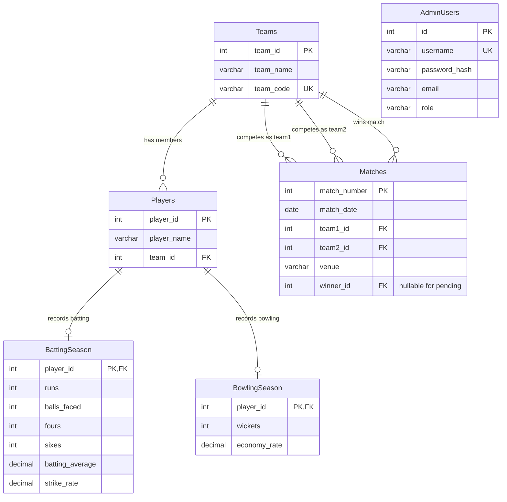

# CricketVerse — Full-Stack Cricket Statistics & IPL Analytics Platform


CricketVerse is a complete, modern, full-stack cricket analytics and tournament statistics web application built with **Python Flask**, **MySQL 8.0**, and **React (Vite + Tailwind CSS + Chart.js)**. Designed with a dark navy broadcast aesthetic and vibrant cricket-leather orange accents, it provides comprehensive IPL 2026 insights calculated dynamically from real MySQL schema records.

---

## 🌟 Key Features

1. **Home Analytics Dashboard**:
   - High-level counters: 10 franchises, 110 players, 74 matches (73 completed, 1 pending result).
   - Live leaderboards for Orange Cap (Runs), Purple Cap (Wickets), and Power Hitters (Strike Rates).
   - Dedicated pending matches spotlight (Match #12: KKR vs PBKS at Eden Gardens with official "Result Pending" status).
   - Dynamic IPL 2026 Points Standings with win percentage and points calculation.
   - Interactive Chart.js franchise comparisons for total team runs and boundary hits.

2. **Teams Explorer**:
   - Franchise cards for all 10 IPL teams with win rates, squad size, and aggregate runs/wickets.
   - Full 11-player official squad breakdown with individual batting and bowling statistics.
   - Complete fixture match history for each team with Won / Lost / Pending badges.

3. **Players Directory**:
   - Filter and explore all 110 IPL cricketers.
   - Multi-column sorting (Runs, Batting Average, Strike Rate, Wickets, Economy Rate).
   - Search by player name with instant live filtering.
   - Team dropdown filter and configurable pagination (15, 30, 50 per page).
   - Clear distinction between non-bowlers (`-`) and actual zero values (`0`).

4. **Individual Player Profiles**:
   - Detailed scoring breakdown: Runs, Balls, Batting Average, Strike Rate, Fours, Sixes.
   - Calculated boundary metrics: Total Boundary Runs and Boundary Run Percentage.
   - Interactive Doughnut chart showing Run Composition (Boundaries vs Running).
   - Bowling section with wickets and economy rates for tournament bowlers.
   - One-click "Compare Player" shortcut.

5. **Matches & Fixtures Explorer**:
   - All 74 tournament matches with team badges, dates, and venue stadiums.
   - Filter by franchise, stadium venue, date range, or status (All / Completed / Pending).
   - Click to inspect match overview modal with competing teams and official outcome.

6. **Interactive Leaderboards**:
   - 8 dedicated ranking leaderboards:
     1. Orange Cap (Top Runs)
     2. Purple Cap (Top Wickets)
     3. Highest Batting Average
     4. Highest Strike Rate
     5. Most Fours (4s)
     6. Most Sixes (6s)
     7. Best Bowling Economy (excluding non-bowlers)
     8. Franchise Aggregate Comparisons
   - Podium styling (Gold, Silver, Bronze) with tie handling and top-10 interactive bar charts.

7. **Head-to-Head Player Comparison**:
   - Searchable selectors for any two players in the tournament.
   - Quick match-up presets (e.g. *Suryavanshi vs Gill*, *Kohli vs Klaasen*, *Rabada vs Bhuvneshwar*).
   - Stat-by-stat comparison table with green leader crowns (`👑`).
   - Grouped Bar Chart visual spectrum comparing scoring, balls, strike rates, and boundaries.

8. **Admin Management Portal (CRUD)**:
   - Secured with JWT token authentication and PBKDF2:SHA256 password hashing.
   - Full CRUD forms for:
     - **Teams**: Add, edit, and safely delete franchises (with foreign key protection).
     - **Players**: Add, edit player details, and update franchise assignments.
     - **Matches**: Add fixtures, edit venues/dates, and update winners for pending matches.
     - **Batting Statistics**: Add and update player season batting aggregates.
     - **Bowling Statistics**: Add and update player season bowling aggregates.
   - Confirmation modals before destructive operations and toast feedback notifications.

9. **Global Quick Search (`Ctrl + K` / `⌘K`)**:
   - Instant search across Teams, Players, and Matches with categorized direct navigation.

10. **Dark / Light Theme Toggle**:
    - Dark mode (charcoal/navy broadcast dashboard) with seamless light mode switch.

---

## 📱 How to Run on ANY Device

CricketVerse is engineered to run seamlessly across **Windows**, **macOS**, **Linux**, and **Mobile Devices (Smartphones & Tablets)**.

### Option A: Access on Phones / Tablets / Other Laptops via Local Wi-Fi (No Extra Setup!)

When CricketVerse is started on your computer, the Flask backend automatically binds to `0.0.0.0:5000`. This allows any device connected to the same Wi-Fi network to use the full application:

1. Start CricketVerse on your host computer (using Option B or Option C below).
2. Find your computer's local Wi-Fi IP address (e.g., `192.168.0.222`).
3. Open your mobile browser (Safari, Chrome, Firefox) on your phone or tablet and visit:
   ```
   http://192.168.0.222:5000
   ```
4. The full-featured responsive application opens with touch-friendly navigation!

---

### Option B: 1-Click Docker Setup (Recommended for Any PC without Manual Installs)

If your device has Docker installed, you can launch MySQL, Flask, and the Frontend in one single command without installing Python, MySQL, or Node:

```bash
docker compose up --build
```

- Automatically starts a dedicated MySQL 8.0 container pre-seeded with the CricketVerse schema and sample data.
- Automatically builds the React frontend and launches the Flask server.
- Open **`http://localhost:5000`** in any browser.

To stop:
```bash
docker compose down
```

---

### Option C: Standard Local Setup (Windows / Mac / Linux)

#### Prerequisites
- **Python 3.8+** installed (`python --version`)
- **MySQL 8.0+** running (`net start MySQL80` on Windows, or `brew services start mysql` on Mac)

#### 1. Setup Environment
Copy the example environment configuration:
```bash
cp .env.example .env
```
Edit `.env` with your local MySQL credentials:
```ini
DB_HOST=localhost
DB_PORT=3306
DB_NAME=cricketverse
DB_USER=root
DB_PASSWORD=YourPasswordHere
SECRET_KEY=cricketverse-secret-key-2026
JWT_SECRET=cricketverse-jwt-secret-2026
```

#### 2. Install Dependencies
```bash
pip install -r requirements.txt
```

#### 3. Initialize & Verify Database
Run the safe database setup tool:
```bash
python database/init_db.py
```
*This verifies your MySQL connection, ensures the `cricketverse` database and tables are populated, creates the default admin user, and verifies row counts (10 teams, 110 players, 74 matches, etc.).*

The `run.bat` and `run.sh` launchers rebuild the frontend before starting Flask, so the server serves the latest frontend source on each run.

#### 4. Launch Application
- **Windows 1-Click**: Double-click `run.bat` or run:
  ```cmd
  run.bat
  ```
- **Linux / macOS 1-Click**: Run:
  ```bash
  chmod +x run.sh
  ./run.sh
  ```
- **Manual Launch**:
  ```bash
  python backend/app.py
  ```

Open **`http://localhost:5000`** in your browser.

---

### Option D: Developer Mode (Live React Hot-Reloading)

To run the Flask backend and the Vite frontend dev server concurrently:

1. **Terminal 1 (Backend)**:
   ```bash
   python backend/app.py
   ```
   *(Running on `http://localhost:5000`)*

2. **Terminal 2 (Frontend Dev Server)**:
   ```bash
   cd frontend
   npm run dev
   ```
   *(Running on `http://localhost:5173` with automatic `/api` proxying to Flask)*

To rebuild static assets for standalone serving:
```bash
cd frontend
npm run build
```

---

## 🔒 Administrator Portal & Authentication

- Navigate to the **Admin Portal** from the top navigation bar.
- **Default Username:** `admin`
- **Default Password:** `Admin@123`
- Administrators receive a signed JSON Web Token (JWT) stored securely in `localStorage`.
- All administrative POST, PUT, and DELETE endpoints are protected at the API level with the `@admin_required` decorator.

---

## 🧪 Automated Testing

CricketVerse includes an automated test suite verifying endpoint responses, business logic, query sanitization, and foreign key constraint handling:

```bash
python -m unittest backend/tests/test_api.py
```

Expected output:
```
Ran 10 tests in 3.884s
OK
```

Test coverage includes:
- System health diagnostic (`/api/health`)
- Dashboard summary and aggregation integrity
- Teams and squad breakdown
- Players search, filtering, and comparison
- Matches completed vs pending filtering
- Leaderboard rankings and Orange Cap calculations
- Global search multi-entity queries
- Admin authentication and unauthorized request rejection
- CRUD operations workflow
- Foreign key constraint enforcement

---

## 📡 REST API Reference

| Method | Endpoint | Description |
|---|---|---|
| `GET` | `/api/health` | System and MySQL connection status |
| `GET` | `/api/dashboard/summary` | Tournament metrics, run counts, wicket counts |
| `GET` | `/api/dashboard/top-scorers` | Top 5 run scorers |
| `GET` | `/api/dashboard/top-wicket-takers` | Top 5 wicket takers |
| `GET` | `/api/dashboard/strike-rate-leaders`| Top 5 highest batting strike rates |
| `GET` | `/api/dashboard/recent-results` | Recently completed matches |
| `GET` | `/api/dashboard/pending-matches` | Matches with pending results |
| `GET` | `/api/dashboard/team-standings` | Franchise points table and win percentages |
| `GET` | `/api/dashboard/charts` | Team-level run and boundary aggregates |
| `GET` | `/api/teams` | All 10 franchises with squad counts and win rates |
| `GET` | `/api/teams/<id>` | Single team overview and totals |
| `GET` | `/api/teams/<id>/players` | 11-player squad with batting & bowling records |
| `GET` | `/api/teams/<id>/matches` | Fixtures and results for this franchise |
| `GET` | `/api/players` | Paginated players with search, team filter, and sorting |
| `GET` | `/api/players/<id>` | Full player profile, boundary metrics, and rankings |
| `GET` | `/api/players/compare?player1=X&player2=Y` | Head-to-head comparison and leader badges |
| `GET` | `/api/matches` | Matches with status, venue, date, and team filters |
| `GET` | `/api/matches/<num>` | Single fixture details |
| `GET` | `/api/matches/pending` | Only pending fixtures |
| `GET` | `/api/matches/completed` | Only completed fixtures |
| `GET` | `/api/stats/leaderboards` | Full 7-category player leaderboards with rankings |
| `GET` | `/api/stats/teams` | Franchise comparative statistics |
| `GET` | `/api/search?q=<query>` | Instant global search across teams, players, matches |
| `POST` | `/api/admin/login` | Admin authentication returning JWT |
| `GET` | `/api/admin/me` | Verify admin token profile |
| `POST` | `/api/admin/teams` | Add franchise *(Admin Token Required)* |
| `PUT` | `/api/admin/teams/<id>` | Update franchise *(Admin Token Required)* |
| `DELETE`| `/api/admin/teams/<id>` | Delete franchise *(Admin Token Required)* |
| `POST` | `/api/admin/players` | Add player *(Admin Token Required)* |
| `PUT` | `/api/admin/players/<id>` | Update player *(Admin Token Required)* |
| `DELETE`| `/api/admin/players/<id>` | Delete player *(Admin Token Required)* |
| `POST` | `/api/admin/matches` | Add match *(Admin Token Required)* |
| `PUT` | `/api/admin/matches/<num>` | Update match or set winner *(Admin Token Required)* |
| `DELETE`| `/api/admin/matches/<num>` | Delete match *(Admin Token Required)* |
| `POST` | `/api/admin/batting` | Create/update batting statistics *(Admin Token Required)* |
| `POST` | `/api/admin/bowling` | Create/update bowling statistics *(Admin Token Required)* |

---

## 🗄️ Database Architecture

The database is named **`CricketVerse`** and consists of the following relational tables:



---

## 🏆 Project Integrity & Compliance Checklist

- [x] Python Flask backend using modular blueprints.
- [x] Connected directly to the provided MySQL database.
- [x] All 10 teams, 110 players, and 74 matches loaded and verified.
- [x] Match #12 correctly displayed as **Result Pending** without fabricated scores.
- [x] Orange Cap, Purple Cap, and 6 other leaderboards calculated using SQL queries.
- [x] Differentiates between non-bowlers (`-`) and actual zero values.
- [x] Interactive Chart.js data visualizations on Dashboard, Player Profiles, and Leaderboards.
- [x] Head-to-head comparison tool with dynamic leader crowns.
- [x] Protected admin area with secure password hashing and full CRUD operations.
- [x] Global quick search accessible via `Ctrl+K`.
- [x] Standalone multi-device access enabled (works on phones, tablets, and computers).
- [x] Automated test suite passing with 10 comprehensive unit tests.
